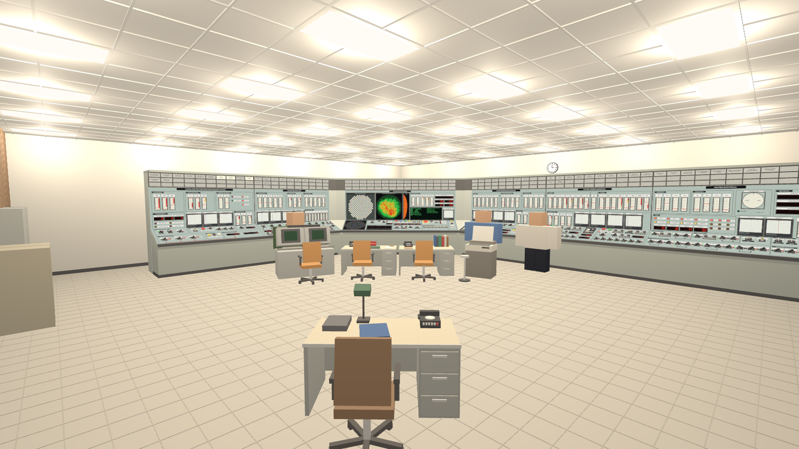
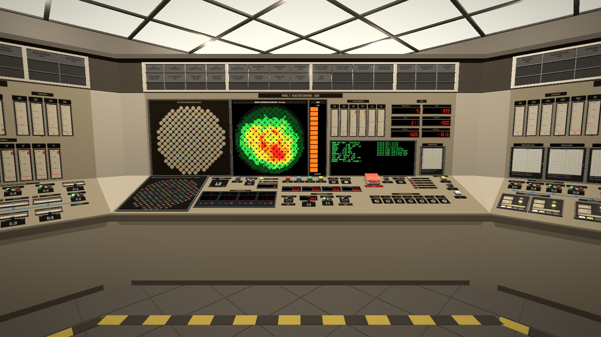
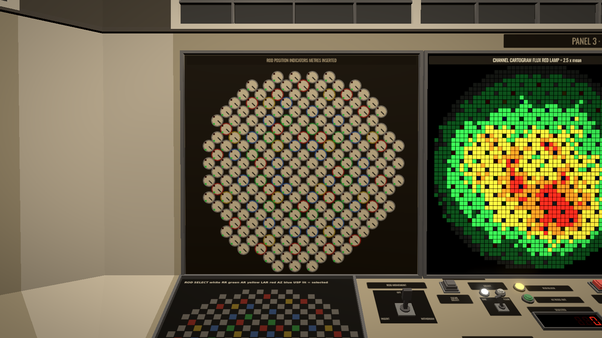
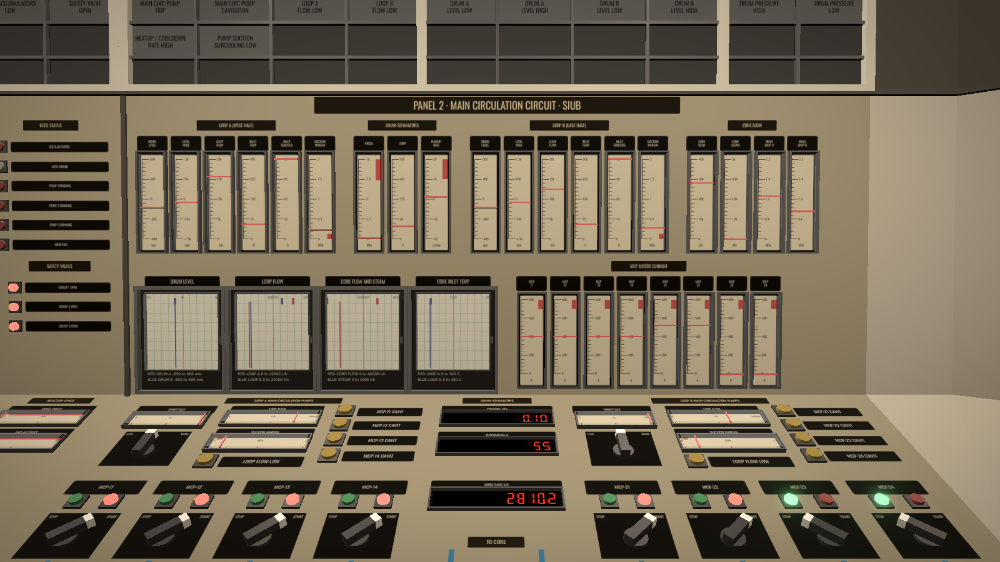
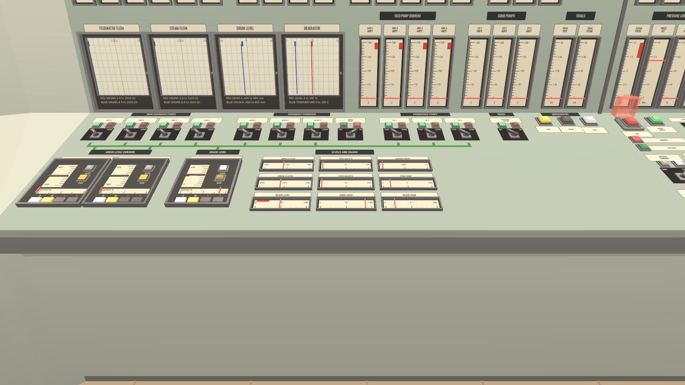
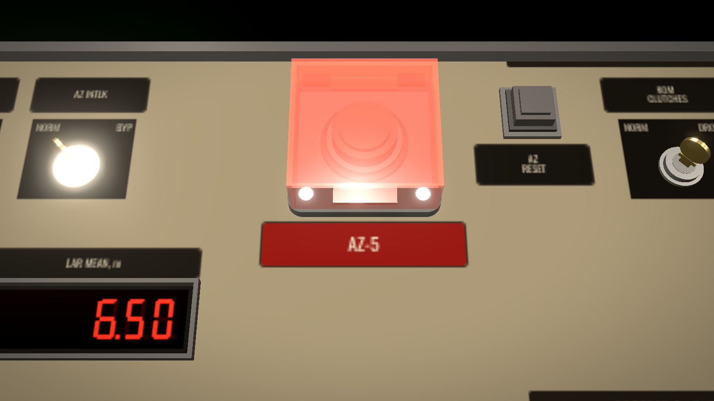
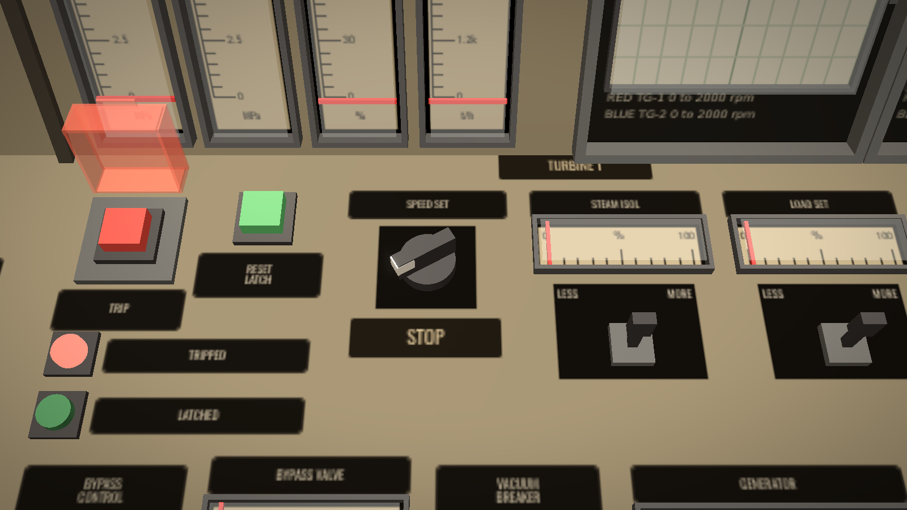
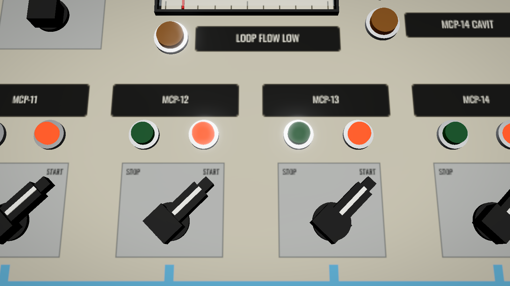

# RBMK-800

A Roblox control-room simulator of an "Americanized" pre-1986 RBMK: the full-size
graphite core (1,661 fuel channels, 211 control rods) derated to 2,560 MW thermal /
800 MW electric, run from a control room laid out like a US boiling-water-reactor
plant. Only the physics and the control room exist; there is no building around it.

It keeps the reactor's real character: a positive void coefficient that grows as rods
come out, a 16-second scram whose first seconds can add reactivity ("positive scram"),
shutdown (AZ) rods, AZ-1 to AZ-5 protection levels, the KOM clutch-release key, xenon
in real time, and fuel channels that burst when you starve or overheat them.















*Preview renders. These are drawn outside Roblox from exactly the parts and panel artwork
the game's scripts create, so the geometry is the game's; Roblox's own lighting and
materials will look different. The blocky figures are added to the previews only, at the
size of a standard Roblox character, to show the scale.*

## Getting it into Roblox Studio

Open **`RBMK-800.rbxlx`** in Roblox Studio (File > Open from File) and press Play.
That file is built from the source in `src/` and contains everything.

If you later want to edit the scripts as files instead of inside Studio, the repository
is a standard [Rojo](https://rojo.space) project (`default.project.json`); `rojo serve`
plus the Rojo Studio plugin will sync `src/` into an open place. You do not need Rojo
just to play.

The server needs a few seconds at startup to design the core ("Commissioning the unit").
The version is shown in the bottom-right corner of the screen.

If an earlier version had you import `RBMKModels.glb` (Blender models of the panel
hardware), delete the `RBMKModels` model from the Explorer and save: the hardware is built
from parts now. The game also takes it out of the room by itself when it starts.

## Playing

| Key | Action |
| --- | --- |
| Click | Operate the control under the mouse. Raise/lower buttons and the rod movement switch act while held (left half of the switch inserts, right half withdraws). |
| Click a guarded button | AZ-5, ECCS MANUAL INITIATE and the turbine TRIP buttons sit under hinged covers: the first click lifts the cover, the next one presses the button. |
| Right-click | Close a lifted cover; turn a selector back one position. |
| Hover | Name and live reading of anything on a panel. |
| E | Sit at the nearest panel (locks the camera on it). E again to stand up. |
| A / D | While seated: move to the next panel. |
| W / S | While seated: bench view, board view, wide view. |
| Mouse wheel | While seated: zoom. |
| P | Procedures binder: startup checklist, shutdown, emergencies, limits. |

The room is set in 1979: an RBMK built in the United States, with an American control
room of the period, laid out and equipped the way General Electric boiling-water-reactor
plants were. The boards form an L, numbered GE-style: **H11-P601** reactor auxiliaries
and emergency cooling and **H11-P602** main circulation on the left wing, and **H11-P604**
feedwater, **H11-P605** turbines and **H11-P606** electrical along the back wall, the two
runs square to each other. **H11-P603** reactor control (rod controls, AZ-5, cartogram)
stands in the corner itself, set across it at 45 degrees, with the cabinets behind it
filled out to the square corner. The operators' desks face the corner, so the reactor
panel is straight ahead. RBMK terms (AZ-5, KOM, ORM, cartogram) are kept. Every server
runs one shared unit; anyone can operate any panel.

The room is life-size around a standard Roblox character: the bench front is at hip
height (0.9 m), the annunciator windows top out a little under 3 m, desks are 0.74 m
high and the ceiling is 3.8 m up. Nothing in it is later than 1979:

- **Boards** are laid out the way GE boards of the period were: on each vertical board,
  rows of identical narrow black-cased edgewise meters (GE type 180 style: white scale
  behind glass, twenty divisions, the unit on the dial, red pointer), each under its own
  engraved nameplate, a black group plate over each system, and a row of strip-chart
  recorders; on each bench, rows of control switch modules, each a nameplate, a pair of
  domed red and green indicating lamps (white on mode switches) and a black escutcheon
  engraved with its two positions carrying a pistol-grip handle or a key lock. Valves and
  setpoints are moved with spring-return LOWER / RAISE switches under small horizontal
  position meters. Pushbuttons are oiltight, with chrome collars. Coloured mimic lines
  trace the flow paths (reactor water blue, steam red, feedwater green, emergency
  cooling orange, power black). Every large pump has a motor ammeter. Digital readouts
  are few: small red LED panel meters for the process computer's figures and for rod
  positions and setpoints, and mechanical counters for ruptured, damaged and
  flow-blocked channels. Boards are pale gray-green with a black rubber bumper and kick
  strip. Hover over any instrument for its exact reading.
- **Reactor board (H11-P603)**, the widest section: on the vertical board, the rod
  position indicators (a synchro dial for every one of the 211 rods, laid out as in the
  core, with a red lamp at full out and a green one at full in, as on the RBMK's rod
  position board), the channel cartogram, the axial power bargraph, neutron monitoring
  meters and a neutron power recorder. On the bench, rod control in the GE manner: a rod
  select matrix of pushbuttons in core geometry, a spring-return rod movement switch
  (INSERT / OFF / WITHDRAW) and a four-rod display giving each selected rod's
  coordinates, position and FULL IN / FULL OUT / STUCK lamps; then rod group selection,
  the power regulators, the emergency protection and the bypass keys.
- **Controllers** are manual/automatic stations: a process scale with a red setpoint
  index, AUTO and MAN lamps, an output meter, and A / M / lower / raise pushbuttons (drum
  level A and B, deaerator level, the pressure regulator).
- **Pumps**: motor current meters for every large pump (main circulation, feed,
  emergency feed, condensate, emergency core cooling, rod channel cooling), and flow
  meters for each main circulation and feed pump.
- **Annunciators** follow the ringback sequence of ISA S18.1 (1979): a new alarm flashes
  fast with the horn until ACKNOWLEDGE, then stays steady; when it clears it flashes
  slowly until RESET; TEST lights every window on the panel while held. The pushbuttons
  are on H11-P601, P603 and P604. In Roblox the board artwork takes the room's lighting,
  while the self-lit displays (annunciator windows, LED digits, the cartogram, the
  computer's tube) glow on their own.
- **Room**: waxed vinyl tile floor with a black rubber cove base, walnut paneling on the
  back wall, an acoustic tile ceiling with fluorescent troffers, a lit exit sign and an
  electric wall clock.
- **Furniture**: two steel operators' desks with key telephones (the red one is the
  direct line to the grid dispatcher), logbooks and binders; the plant process
  computer's console with two green CRTs (unit summary and alarm summary); a GE TermiNet
  alarm typer printing the event log; a floor-standing ashtray; the shift supervisor's
  desk; steel shelving of procedures; file cabinets; and a chalkboard where the shift
  status is kept up to date.

The place is set up for Roblox's Future lighting.

Where the RBMK features are on the boards:

| Feature | Where |
| --- | --- |
| AZ-5 scram button, AZ-1 to AZ-5 lamps, KOM clutch key | P603 bench, EMERGENCY PROTECTION |
| Shutdown (AZ) rods, shortened rods (USP), regulators | P603 bench: ROD GROUPS, ROD MOTION, POWER REGULATORS |
| Rod positions | P603 board: ROD POSITION INDICATORS, one dial per rod; FOUR ROD DISPLAY on the bench |
| Void coefficient, operational reactivity margin (ORM) | P603 board, beside reactivity |
| Channel ruptures and reactor space pressure | P601 board, CHANNEL INTEGRITY and the REACTOR SPACE recorder; magenta lamps on the cartogram |
| Positive scram | watch POWER RANGE and PERIOD on P603 in the first seconds after AZ-5 |

The panel equipment follows published descriptions of GE boiling-water-reactor control
rooms of the period (the NRC's GE BWR/4 technology manuals: rod select matrix, rod
movement and notch override switches, four-rod and full-core displays, reactor
protection controls, manual/automatic controller stations), the ISA S18.1-1979
annunciator sequences, and descriptions of the RBMK control room (rod position synchro
indicators laid out as the core, with limit lamps; the core mimic of channel lamps).

The unit starts in cold shutdown. Following the checklist, a startup takes about 90
minutes; ignoring the heatup and turbine warm-up limits it can be done in about 20,
at the cost of wear that shows up later as burst channels and failed equipment.
Automatic controllers (power regulators, drum level, pressure, deaerator level) are all
optional; the time spent under automatic control is recorded for a future scoring system.

If the reactor is destroyed, a new unit is commissioned after about a minute.

## What is simulated

- **Core**: one-group neutron diffusion on the real lattice with 14 axial layers, six-group
  point kinetics, xenon and iodine per node, fuel/graphite temperatures and boiling in every
  channel, with void, Doppler, graphite and xenon feedback. Rods are modelled as absorber,
  graphite displacer and water column, so rod worth, power tilts and the positive scram all
  come out of the physics rather than being scripted.
- **Damage**: dryout, fuel melting, pressure-tube rupture into the reactor space, lid lift
  if too many tubes burst at once, tube wear from thermal shock, seized rods.
- **Main circulation**: eight pumps with coastdown and cavitation, natural circulation,
  two drum-separator loops with level swell and shrink.
- **Steam and feedwater**: pressure regulator and turbine bypass, two turbines with warm-up
  stress, vibration and trips, condensers and vacuum, deaerator, feed and condensate pumps,
  three-element level control, safety valves.
- **Electrical**: generator excitation and synchronising, auxiliary buses with reserve
  transfer, emergency buses and diesels, islanded "rundown" operation.
- **Control room**: a walkable 3D room. Buttons, switch levers, key switches, knobs, lamp
  lenses, meter needles and the bezels around every instrument are physical parts; scales,
  legends and screens are drawn on the panel faces.
- **Protection**: AZ-1 to AZ-5 with first-out logging and key-switch bypasses, ECCS,
  rod-channel cooling, about 85 annunciators.
- **Failures**: random equipment faults roughly every half hour of operation, more often on
  a plant that has been treated roughly.

Deliberate departures from a real plant, all in `src/shared/Config.luau`: the circuit's
thermal mass is about a tenth of the real figure so heatup fits in a session, and the grid
is American (60 Hz, 1,800 rpm). Fast physics, rod speeds, xenon and graphite run in real time.

## Layout of the repository

| Path | Contents |
| --- | --- |
| `src/shared` | Design data (`Config`), core map, steam tables, the control-room layout as data (`PanelLayout`), annunciator list, procedures text. |
| `src/server/Sim` | The plant model. No Roblox APIs, so it also runs in the tests. |
| `src/server` | Room builder and the server script that runs and replicates the plant. |
| `src/client` | Instrument drawing and panel hardware, mouse interaction and panel view, procedures binder. |
| `tests` | Headless tests (see below). |

Adding or moving a control is a one-line change in `PanelLayout.luau`; `tests/layout_check`
verifies that every widget fits, nothing overlaps, and every signal and command exists.

## Tests

The tests run outside Roblox with [Lune](https://lune-org.github.io/docs) (`cargo install lune`):

```
lune run tests/layout          # core map generation
lune run tests/core_static     # criticality, rod worth, void effect, positive scram
lune run tests/core_dynamic    # free-running core
lune run tests/plant_smoke     # whole plant in cold shutdown
lune run tests/layout_check    # control room vs. plant signals and commands
lune run tests/transients      # pump trip, feed loss, channel rupture, turbine trip, scram, the 1986 sequence
lune run tests/startup         # scripted cold startup to full power (about 4 minutes to run)
lune run tests/roblox_mock     # server and client scripts run against each other, every control clicked
```

`tests/roblox_mock` uses Roblox's own class and property database to check everything the
scripts create, but it is not Roblox Studio: the game has not yet been run in Studio itself.

To rebuild the place file after changing the source: `rojo build -o RBMK-800.rbxlx`.
