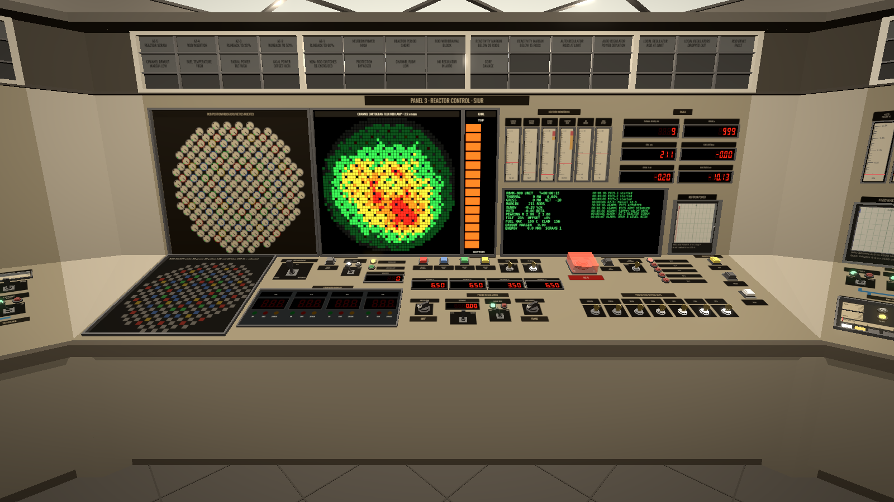
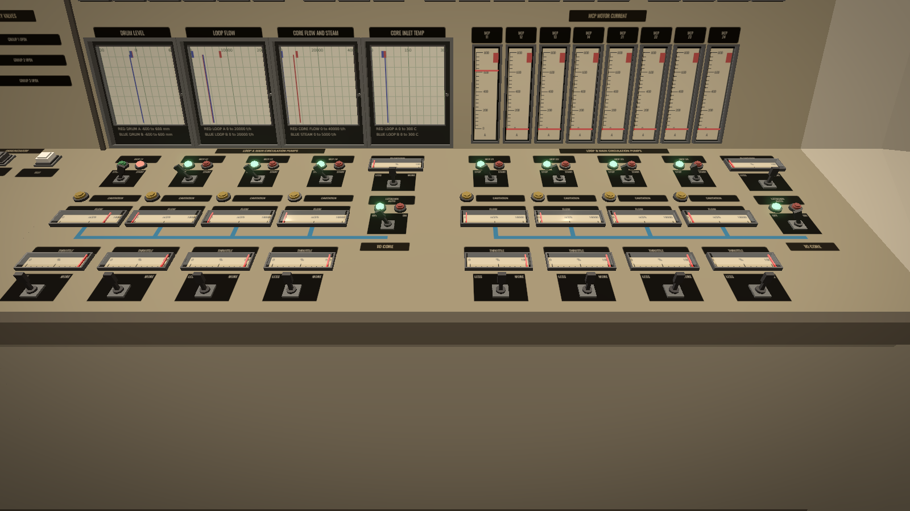
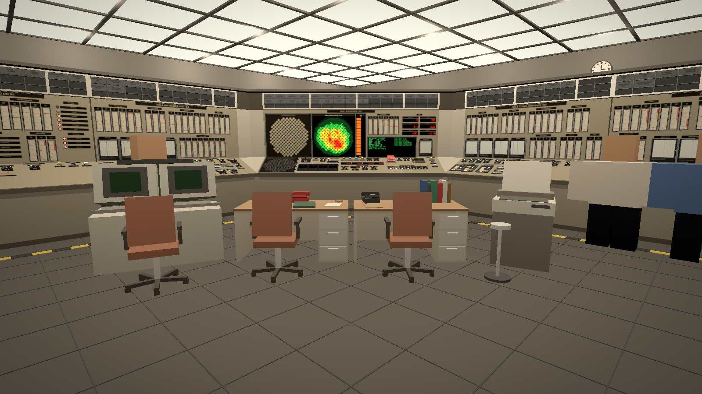
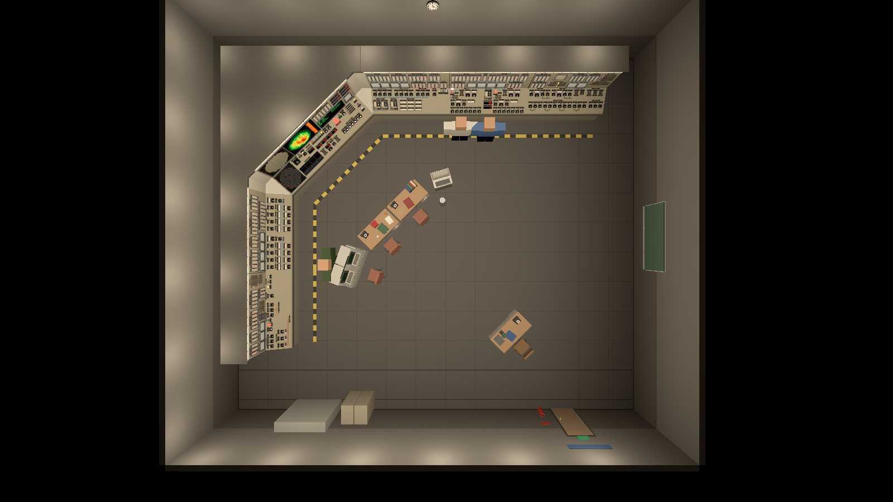
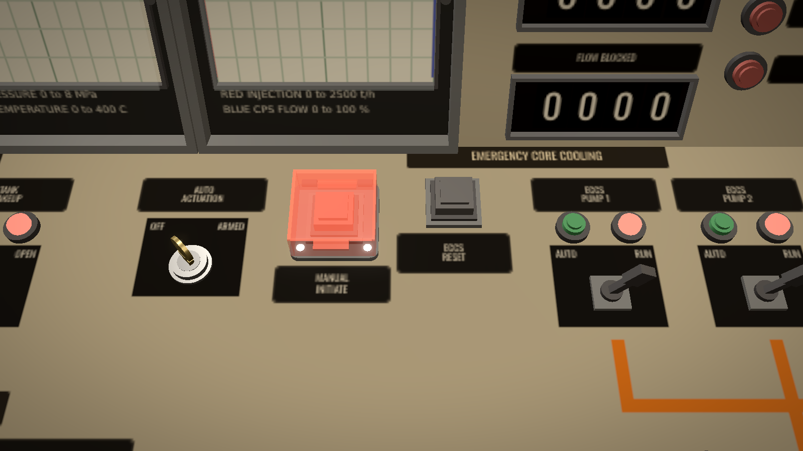

# RBMK-800

A Roblox control-room simulator of an "Americanized" pre-1986 RBMK: the full-size
graphite core (1,661 fuel channels, 211 control rods) derated to 2,560 MW thermal /
800 MW electric, built for the American 60 Hz grid. It keeps the Soviet design's control
room, given a moody, stylized look and labelled in English. Only the physics and the control
room exist; there is no building around it.

It keeps the reactor's real character: a positive void coefficient that grows as rods
come out, a 16-second scram whose first seconds can add reactivity ("positive scram"),
shutdown (AZ) rods, AZ-1 to AZ-5 protection levels, the KOM clutch-release key, xenon
in real time, and fuel channels that burst when you starve or overheat them.














*Preview renders. These are drawn outside Roblox from exactly the parts and panel artwork
the game's scripts create, so the geometry is the game's; Roblox's own lighting and
materials will look different, though the previews imitate the game's bloom and colour
grade. The blocky figures are added to the previews only, at the size of a standard
Roblox character, to show the scale.*

## Getting it into Roblox Studio

Open **`RBMK-800.rbxlx`** in Roblox Studio (File > Open from File) and press Play.
That file is built from the source in `src/` and contains everything.

If you later want to edit the scripts as files instead of inside Studio, the repository
is a standard [Rojo](https://rojo.space) project (`default.project.json`); `rojo serve`
plus the Rojo Studio plugin will sync `src/` into an open place. You do not need Rojo
just to play.

The server needs a few seconds at startup to design the core ("Commissioning the unit").
The version is shown in the bottom-right corner of the screen.

If an earlier version had you import `RBMKModels.glb` (Blender models of the panel
hardware), delete the `RBMKModels` model from the Explorer and save: the hardware is built
from parts now. The game also takes it out of the room by itself when it starts.

## Playing

| Key | Action |
| --- | --- |
| Click | Operate the control under the mouse. Raise/lower buttons and the rod movement switch act while held (left half of the switch inserts, right half withdraws). |
| Click a guarded button | AZ-5, ECCS MANUAL INITIATE and the turbine TRIP buttons sit under hinged covers: the first click lifts the cover, the next one presses the button. |
| Right-click | Close a lifted cover; turn a selector back one position. |
| Hover | Name and live reading of anything on a panel. |
| E | Sit at the nearest panel (locks the camera on it). E again to stand up. |
| A / D | While seated: move to the next panel. |
| W / S | While seated: bench view, board view, wide view. |
| Mouse wheel | While seated: zoom. |
| P | Procedures binder: startup checklist, shutdown, emergencies, limits. |

The unit is Americanized (English labels, the 60 Hz grid), but its control room follows
the Soviet RBMK unit control rooms, with a moody, stylized art direction rather than
photo-realism: putty-beige boards packed with instruments, light boxes that stay dark until
they light, glowing lamps and screens, a bright ceiling of luminous panels over a dimmer
room, a dark floor with yellow and black hazard stripes, and a warm, contrasty colour
grade. Shapes are kept simple (blocks and cylinders, no spheres). The boards form an L. On the left wing: **Panel 1** reactor
auxiliaries and emergency cooling and **Panel 2** main circulation (the SIUB's, the senior
unit engineer). Along the back wall: **Panel 4** feedwater (SIUB), **Panel 5** turbines
(SIUT, the senior turbine engineer) and **Panel 6** electrical. **Panel 3**, reactor control,
is the SIUR's post (the senior reactor control engineer): it stands in the corner itself,
set across it at 45 degrees, with the cabinets behind it filled out to the square corner.
The operators' desks face the corner, so the reactor panel is straight ahead. RBMK terms
(AZ-5, KOM, ORM, SKALA, cartogram) are kept. Every server runs one shared unit; anyone can
operate any panel.

The room is life-size around a standard Roblox character: the console front is at hip
height (0.9 m), the light boxes top out a little under 3 m, desks are 0.74 m high and the
ceiling is 3.8 m up.

- **Boards**: on each vertical board, rows of narrow black-cased profile meters (white
  scale, red pointer, coloured limit bands) under black engraved nameplates in white condensed
  capitals, a dark title plate over each system, and a row of strip-chart recorders. On
  each console, chunky hardware that reads from across the room: black levers that stand
  up off the console and tip towards their position, under a pair of round lamps that
  glow (green off, red on) and an engraved plate with its two positions; key switches
  with brass keys; square pushbuttons with tall caps; black knobs with a tall fin.
  Valves and setpoints are moved with spring-return levers marked LESS / MORE. Thick
  mimic lines trace the flow paths (water light blue, steam red, emergency cooling
  orange, power black). Every large pump has a motor ammeter. Digital readouts are red,
  and mechanical counters count ruptured,
  damaged and flow-blocked channels. Boards and consoles are putty beige with dark
  trim. Hover over any instrument for its exact reading.
- **Reactor board (Panel 3)**, the widest section: on the vertical board, the rod position
  indicators (a dial for every one of the 211 rods, laid out as in the core, with a red
  lamp at full out and a green one at full in), the channel cartogram, the axial power
  bargraph, neutron monitoring meters, the SKALA figures and display, and a neutron power
  recorder. On the console, the SIUR's desk: rod selection keys in core geometry, the
  spring-return rod movement key (INSERT / OFF / WITHDRAW) and a four-rod display giving
  each selected rod's coordinates, position and FULL IN / FULL OUT / STUCK lamps; then rod
  group selection, the power regulators, the emergency protection and the bypass keys.
- **Guarded buttons**: AZ-5, a big round red button with a red nameplate, sits under a
  hinged red cover, as the real one did (the operator lifted the cover before pressing
  it); ECCS MANUAL INITIATE and the turbine TRIP buttons are guarded the same way. Click
  once to lift the cover, again to press, right-click to close it.
- **Controllers** are manual/automatic stations: a process scale with a red setpoint
  index, AUTO and MAN lamps, an output meter, and A / M / lower / raise pushbuttons (drum
  level A and B, deaerator level, the pressure regulator).
- **Pumps**: motor current meters for every large pump (main circulation, feed,
  emergency feed, condensate, emergency core cooling, rod channel cooling), and flow
  meters for each main circulation and feed pump.
- **Light boxes** run along the top of every panel and follow a ringback sequence: a new
  alarm flashes fast with the horn until ACKNOWLEDGE, then stays steady; when it clears it
  flashes slowly until RESET; TEST lights every window on the panel while held. The
  windows are grouped in boxes of four columns in beige frames: gray with a dark legend
  when unlit, white when lit, red for the emergency ones. The pushbuttons are on
  Panels 1, 3 and 4. In Roblox the board artwork takes the room's lighting, while the
  self-lit displays (light boxes, digits, the cartogram, the SKALA tube) glow on their
  own.
- **Room**: a dark tiled floor with yellow and black hazard stripes along the boards, dark
  gray walls, a ceiling of square luminous panels, an electric wall clock and a green exit
  sign.
- **Furniture**: two operators' desks with rotary telephones (the red one, with no dial,
  is the direct line to the grid dispatcher), logbooks and binders; the SKALA computer's
  console with two green displays (unit summary and alarm summary); the alarm printer
  printing the event log; an ashtray stand; the shift supervisor's desk; shelving of
  procedures; file cabinets; and a chalkboard where the shift status is kept up to date.

The place is set up for Roblox's Future lighting, with a low warm ambient light, bloom
on everything that glows, and a warm, contrasty colour grade (the `Lighting` settings in
`default.project.json`).

Where the RBMK features are on the boards:

| Feature | Where |
| --- | --- |
| AZ-5 scram button, AZ-1 to AZ-5 lamps, KOM clutch key | Panel 3 console, EMERGENCY PROTECTION |
| Shutdown (AZ) rods, shortened rods (USP), regulators | Panel 3 console: ROD GROUPS, ROD MOTION, POWER REGULATORS |
| Rod positions | Panel 3 board: ROD POSITION INDICATORS, one dial per rod; FOUR ROD DISPLAY on the console |
| Void coefficient, operational reactivity margin (ORM) | Panel 3 board, SKALA figures |
| Channel ruptures and reactor space pressure | Panel 1 board, CHANNEL INTEGRITY and the REACTOR SPACE recorder; magenta lamps on the cartogram |
| Positive scram | watch POWER RANGE and PERIOD on Panel 3 in the first seconds after AZ-5 |

The look follows descriptions and photographs of the Soviet RBMK control rooms: the
SIUR's console with rod selection keys, the board of rod position dials laid out as the
core, the cartogram of channel lamps (on the real units white for fuel channels, yellow
for channels with in-core detectors, green for rod channels, as on the
[mnemonic display lamp cover kept by the ORAU museum](https://orau.org/health-physics-museum/collection/accidents/light-cover-from-chernobyl.html)),
light boxes along the top of the boards, and an AZ-5 button under a protective cover that
the operator lifted before pressing it ([Dyatlov's account](https://www.scribd.com/document/708251356/How-it-was-Anatoly-Dyatlov)).

The unit starts in cold shutdown. Following the checklist, a startup takes about 90
minutes; ignoring the heatup and turbine warm-up limits it can be done in about 20,
at the cost of wear that shows up later as burst channels and failed equipment.
Automatic controllers (power regulators, drum level, pressure, deaerator level) are all
optional; the time spent under automatic control is recorded for a future scoring system.

If the reactor is destroyed, a new unit is commissioned after about a minute.

## What is simulated

- **Core**: one-group neutron diffusion on the real lattice with 14 axial layers, six-group
  point kinetics, xenon and iodine per node, fuel/graphite temperatures and boiling in every
  channel, with void, Doppler, graphite and xenon feedback. Rods are modelled as absorber,
  graphite displacer and water column, so rod worth, power tilts and the positive scram all
  come out of the physics rather than being scripted.
- **Damage**: dryout, fuel melting, pressure-tube rupture into the reactor space, lid lift
  if too many tubes burst at once, tube wear from thermal shock, seized rods.
- **Main circulation**: eight pumps with coastdown and cavitation, natural circulation,
  two drum-separator loops with level swell and shrink.
- **Steam and feedwater**: pressure regulator and turbine bypass, two turbines with warm-up
  stress, vibration and trips, condensers and vacuum, deaerator, feed and condensate pumps,
  three-element level control, safety valves.
- **Electrical**: generator excitation and synchronising, auxiliary buses with reserve
  transfer, emergency buses and diesels, islanded "rundown" operation.
- **Control room**: a walkable 3D room. Buttons and their covers, levers, key
  switches, knobs, lamp lenses, meter needles and the bezels around every instrument are
  physical parts; scales, legends and screens are drawn on the panel faces.
- **Protection**: AZ-1 to AZ-5 with first-out logging and key-switch bypasses, ECCS,
  rod-channel cooling, about 85 annunciators.
- **Failures**: random equipment faults roughly every half hour of operation, more often on
  a plant that has been treated roughly.

Deliberate departures from a real plant, all in `src/shared/Config.luau`: the circuit's
thermal mass is about a tenth of the real figure so heatup fits in a session, and the grid
is American, as befits an Americanized unit: 60 Hz with 1,800 rpm turbines (the Soviet
units ran on 50 Hz at 3,000 rpm). Fast physics, rod speeds, xenon and graphite run in real time.

## Layout of the repository

| Path | Contents |
| --- | --- |
| `src/shared` | Design data (`Config`), core map, steam tables, the control-room layout as data (`PanelLayout`), annunciator list, procedures text. |
| `src/server/Sim` | The plant model. No Roblox APIs, so it also runs in the tests. |
| `src/server` | Room builder and the server script that runs and replicates the plant. |
| `src/client` | Instrument drawing and panel hardware, mouse interaction and panel view, procedures binder. |
| `tests` | Headless tests (see below). |

Adding or moving a control is a one-line change in `PanelLayout.luau`; `tests/layout_check`
verifies that every widget fits, nothing overlaps, and every signal and command exists.

## Tests

The tests run outside Roblox with [Lune](https://lune-org.github.io/docs) (`cargo install lune`):

```
lune run tests/layout          # core map generation
lune run tests/core_static     # criticality, rod worth, void effect, positive scram
lune run tests/core_dynamic    # free-running core
lune run tests/plant_smoke     # whole plant in cold shutdown
lune run tests/layout_check    # control room vs. plant signals and commands
lune run tests/transients      # pump trip, feed loss, channel rupture, turbine trip, scram, the 1986 sequence
lune run tests/startup         # scripted cold startup to full power (about 4 minutes to run)
lune run tests/roblox_mock     # server and client scripts run against each other, every control clicked
```

`tests/roblox_mock` uses Roblox's own class and property database to check everything the
scripts create, but it is not Roblox Studio: the game has not yet been run in Studio itself.

To rebuild the place file after changing the source: `rojo build -o RBMK-800.rbxlx`.
